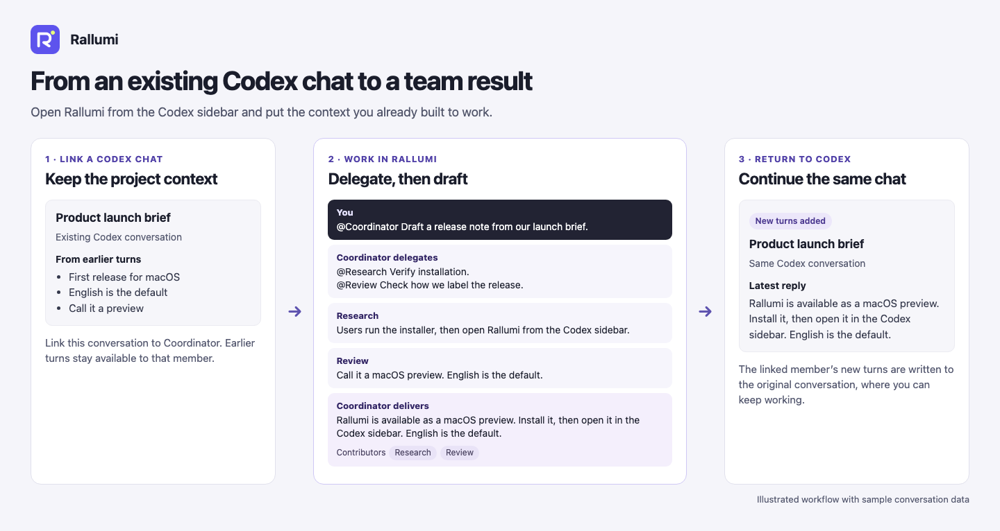
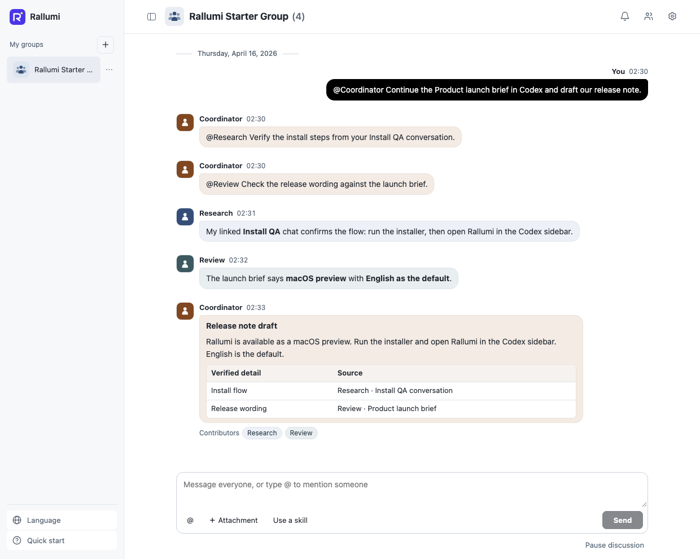
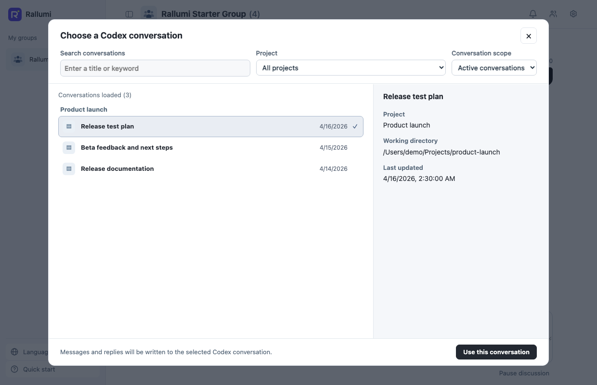

# Rallumi

**Turn your existing Codex conversations into a team, right in the Codex sidebar.**

Rallumi is built on Codex. Open it inside the desktop app, connect an existing Codex conversation to a group member, and give that member work using the context it already has.

[Download the macOS preview](https://github.com/wwa821/rallumi/releases/tag/v0.1.0)



## What you keep from Codex

- **Your existing history and project context.** Connect a member to a Codex conversation and it continues from the same thread. New messages and replies from that member are written back to the original conversation.
- **Codex’s native subagents.** A member can use temporary Codex subagents for work that benefits from delegation. Their activity can appear in Rallumi’s organization chart when Codex reports it.
- **Your existing desktop workflow.** Open Rallumi from the Codex sidebar and work through your signed-in Codex account. Group settings and the Rallumi transcript are stored locally on your Mac.

## What Rallumi adds

Assign a task to a coordinator or mention individual specialists. A coordinator can answer directly or ask other members for help. Rallumi gathers member replies and marks contributors on the final answer. Hide intermediate collaboration messages when you want a quieter chat.

In this example, Coordinator continues an existing launch brief, delegates two checks, and turns the replies into a release note with sources and contributor labels.



### Link a Codex conversation

In **Members → Add member**, choose **Use existing Codex conversation**. You choose exactly which conversation to link to each member.



### Set up reporting lines

Use the organization chart to connect coordinators and specialists, add members, and edit reporting relationships as your team changes.


The illustration and screenshots use sample data.

## Install on macOS

1. Install and sign in to the Codex desktop app.
2. Download and unzip **Rallumi-Preview-macOS.zip**, then run **Install Rallumi.command**. If needed, the installer downloads a Node.js runtime from nodejs.org.
3. Open Rallumi in the Codex sidebar. If the icon doesn't appear, quit and reopen Codex.

Try sending `@Coordinator Help me outline a three-step test plan.` in **Rallumi Starter Group**. The first task assigned to a starter agent creates its Codex conversation.

English is the default. Use **Language** in the left sidebar to switch to Simplified Chinese. Group settings and message history are stored on your Mac.

## Build the panel

The release includes the built panel. If you edit the frontend, rebuild it with Node.js 24 or later and an esbuild executable.

```sh
node plugins/rallumi/build-panel.mjs service/public "$(command -v esbuild)"
```

## License

Rallumi is source-available under the [PolyForm Noncommercial License 1.0.0](LICENSE). Personal, noncommercial use is permitted. Commercial use requires a separate written license. For commercial licensing, contact the [maintainer](https://github.com/wwa821).

The bundled [markdown-it library](service/public/vendor/markdown-it.LICENSE) retains its own license.
