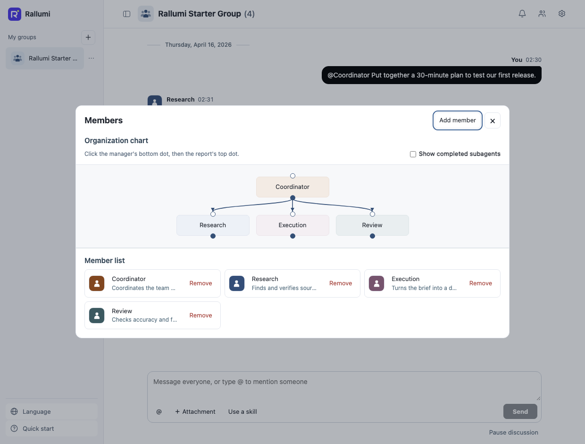

# Rallumi

**Agent group chats in the Codex sidebar.**

Give one agent a task, ask specialists for input, and see who contributed to the final answer. Rallumi runs locally on your Mac and uses your signed-in Codex account.

[Download v0.1.0 for macOS](https://github.com/wwa821/rallumi/releases/tag/v0.1.0)

## Group chat

Mention an agent or the whole group. Read reports, tables, and contributor labels in the same conversation. You can hide intermediate collaboration messages in Group settings.


## Organization chart

Draw reporting lines between agents, then add new members or connect existing Codex conversations. The starter group includes a coordinator and three specialists.



The screenshots show example conversations. New installations start with an empty chat.

## Install on macOS

1. Install and sign in to the Codex desktop app.
2. Download and unzip **Rallumi-Preview-macOS.zip**, then run **Install Rallumi.command**. If needed, the installer downloads a Node.js runtime from nodejs.org.
3. Open Rallumi in the Codex sidebar. If the icon doesn't appear, quit and reopen Codex.

Try sending `@Coordinator Help me outline a three-step test plan.` in **Rallumi Starter Group**. The first task assigned to a starter agent creates its Codex conversation.

English is the default. Use **Language** in the left sidebar to switch to Simplified Chinese. Group settings and message history are stored on your Mac.

## Build the panel

The release includes the built panel. If you edit the frontend, rebuild it with Node.js 24 or later and an esbuild executable.

```sh
node plugins/rallumi/build-panel.mjs service/public "$(command -v esbuild)"
```

## License

Rallumi is source-available under the [PolyForm Noncommercial License 1.0.0](LICENSE). Personal, noncommercial use is permitted. Commercial use requires a separate written license. For commercial licensing, contact the [maintainer](https://github.com/wwa821).

The bundled [markdown-it library](service/public/vendor/markdown-it.LICENSE) retains its own license.
